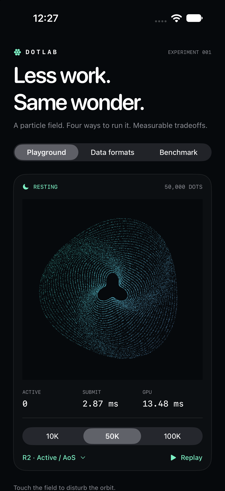

# DotLab

An iOS particle experiment by **Alper Karatas**. Touch an orbital illustration, watch it spring back, and compare what happens when you change its file format, animation scheduling, and simulation memory layout.

The question: **How much work can we remove while preserving the same image and interaction?**



## Run the app

Requirements: Xcode 16 or newer, iOS 17 or newer, and a Metal-capable device or simulator. Use a physical iPhone and a Release build for performance conclusions. The checked-in Xcode project has no third-party dependencies.

```sh
open DotLab.xcodeproj
```

Choose the `DotLab` scheme and a destination. For a physical device, select your own development team in Signing & Capabilities. The project deliberately does not contain a development-team identifier.

If Xcode reports a missing Metal compiler:

```sh
xcodebuild -downloadComponent MetalToolchain
```

The three workspaces are:

- **Playground:** 10K, 50K, or 100K particles; four simulation modes; drag interaction and a scripted replay.
- **Data formats:** measure four binary layouts with the same LZFSE compressor and decoded runtime layout.
- **Benchmark:** run a 12-trial smoke test or the 60-trial standard suite, then export JSON through the share sheet or Files.

## What changes between variants?

### File encoding

| ID | Payload layout | Bytes per dot before compression |
|---|---|---:|
| A / 0 | Interleaved Float32 X, Y, radius | 12 |
| B / 1 | Interleaved UInt16 X/Y, UInt8 radius | 5 |
| C / 2 | Quantized X block, Y block, radius block | 5 |
| D / 3 | C with modular deltas within each block | 5 |

All variants include a 16-byte header, preserve source order, use the same compression algorithm, and decode into `[Dot]` with Float32 fields. The source is deterministic. A uniform random dataset acts as a less-structured control. Sorting is not bundled into another optimization, and compression ratios are not assumed to match the source article.

### Simulation and rendering

| Mode | Physics updates | Interaction search | When settled |
|---|---|---|---|
| R0 · Always on | Every dot | Full scan | Keep simulating and rendering |
| R1 · Sleep when settled | Every dot while awake | Full scan | Pause MTKView |
| R2 · Active / AoS | Active dots | Static grid in rest space | Pause MTKView |
| R3 · Active / SoA | Active dots | Same grid as R2 | Pause MTKView |

Every mode uses identical spring equations at a fixed 120 Hz simulation step, the same 60 FPS rendering target, and the same Metal instanced-quad renderer. Active modes still upload and draw the full field on moving frames. This keeps simulation work separate from partial rendering.

The interaction field is explicitly defined around each dot's **rest position**. That makes a static spatial grid equivalent to the full scan; it does not silently omit displaced dots. AoS and SoA are two concrete implementations to measure, not a promise that SoA is faster. The initial host measurements favor AoS, which is the default playground mode.

## Reproduce the measurements

### Core correctness and host CPU benchmark

```sh
swift test
swift run -c release dotbench --output Results/local/macos.json
python3 Scripts/validate-results.py Results/local/macos.json
python3 Scripts/summarize.py Results/local/macos.json --output Results/local/macos.md
```

The host benchmark produces 24 encoding rows and 60 CPU simulation trials. Add `--quick` for fewer repetitions and a shorter interaction, or `--codec-only` to skip simulation. These CPU timings do not measure rendered FPS or iPhone energy consumption.

### Simulator

```sh
xcrun simctl list devices available
Scripts/run-simulator.sh YOUR_SIMULATOR_UDID --benchmark
```

The automated launch arguments are also usable from the Xcode scheme:

```text
--benchmark                  Smoke suite, one repeat per count/mode
--benchmark --standard       Standard suite, five repeats per count/mode
--replay                     One 10-second scripted interaction
--count 100000               Initial playground dot count
--format 2                   Initial playground encoding, IDs 0–3
```

Retrieve a simulator export:

```sh
container=$(xcrun simctl get_app_container YOUR_SIMULATOR_UDID com.alperkaratas.dotlab data)
cp "$container/Documents/device-smoke.json" Results/local/simulator-smoke.json
python3 Scripts/validate-results.py Results/local/simulator-smoke.json
```

### Physical iPhone

Choose **Product → Profile** with the scheme's Release configuration, or build and install from the command line:

```sh
xcodebuild -project DotLab.xcodeproj -scheme DotLab -configuration Release \
  -destination 'generic/platform=iOS' -derivedDataPath /tmp/dotlab-device \
  -allowProvisioningUpdates DEVELOPMENT_TEAM=YOUR_TEAM_ID build

xcrun devicectl device install app --device YOUR_IPHONE_UDID \
  /tmp/dotlab-device/Build/Products/Release-iphoneos/DotLab.app

xcrun devicectl device process launch --device YOUR_IPHONE_UDID \
  --terminate-existing com.alperkaratas.dotlab --benchmark --standard
```

The standard protocol takes about 53 minutes: 60 shuffled trials, each with 1 second warmup, 10 seconds initial idle, 10 seconds scripted interaction, up to 10 seconds settling, and 30 seconds final idle. Keep the app foregrounded. Backgrounding cancels the suite and saves partial results; the app disables automatic screen lock during a suite and restores it afterward.

```sh
xcrun devicectl device copy from --device YOUR_IPHONE_UDID \
  --domain-type appDataContainer --domain-identifier com.alperkaratas.dotlab \
  --source Documents/device-standard.json --destination Results/local/iphone.json

python3 Scripts/validate-results.py Results/local/iphone.json --require-physical --standard
python3 Scripts/summarize.py Results/local/iphone.json --output Results/local/iphone.md
```

Exports are checkpointed after every trial. They include raw samples, summaries, OS/device/GPU metadata, build configuration, thermal states, callback-based missed-refresh estimates, post-trial RSS, and codec error bounds. Only files from this test app's container are needed.

## Interpret the results

- **Open time** includes decompression, validation, and reconstruction into the shared Float32 layout. Disk/network I/O and GPU-buffer creation are excluded.
- **Submission time** is elapsed wall time around simulation, buffer upload, encoding, and submission, including waits. It is not process CPU utilization.
- **GPU time** is command-buffer execution time, not end-to-end display latency.
- **Frame intervals** come from renderer callbacks. Missed refreshes are estimates, not compositor measurements.
- **Idle frames/steps** count work submitted by this renderer. Other app/system work can still occur.
- **RSS** is one post-trial resident-memory sample, not peak memory. Use Allocations/VM tools to inspect peaks.
- **First-frame time** measures renderer reset to first submission. It is not cold application startup or first on-screen presentation.
- **Pixel error** is geometric error at a declared 1179×1179-pixel viewport. It does not establish perceptual equivalence at every zoom level.
- **Energy savings** require separate on-device power traces. Fewer frames alone do not quantify battery-life improvement.

See [the measurement protocol](Docs/PROTOCOL.md), [the binary format](Docs/FORMAT.md), and [recorded results](Results/README.md).

## Project layout

```text
Sources/DotLabCore/     Deterministic datasets, codecs, physics, measurements
Sources/DotBench/       macOS command-line benchmark
Tests/                 Codec safety, error bounds, equivalent trajectories
iOS/DotLab/            SwiftUI interface, Metal renderer, device suite
Scripts/               Launch, validate, summarize, and visual comparison tools
Results/               Raw results and derived reports
project.yml            Optional XcodeGen project source
```

The `.xcodeproj` is committed. Regenerate it after target/file changes with `xcodegen generate`; XcodeGen is not needed to build an existing checkout.

## References

Inspired by Layers Engineering's [Shipping 103,802 dots in 82 KB](https://layers.engineering/shipping-103-802-dots-in-82-kb-b4f7d3a89779). This project uses an original generated illustration, an independent binary format, and LZFSE; it is an experiment in the same principles rather than a reproduction of their exact numbers.

Apple documentation: [MTKView drawing modes](https://developer.apple.com/documentation/metalkit/mtkview), [LZFSE](https://developer.apple.com/documentation/compression/algorithm/lzfse), [Metal performance analysis](https://developer.apple.com/documentation/xcode/analyzing-the-performance-of-your-metal-app), and [Power Profiler](https://developer.apple.com/documentation/xcode/measuring-your-app-s-power-use-with-power-profiler).

## License

MIT. Copyright © 2026 Alper Karatas.
