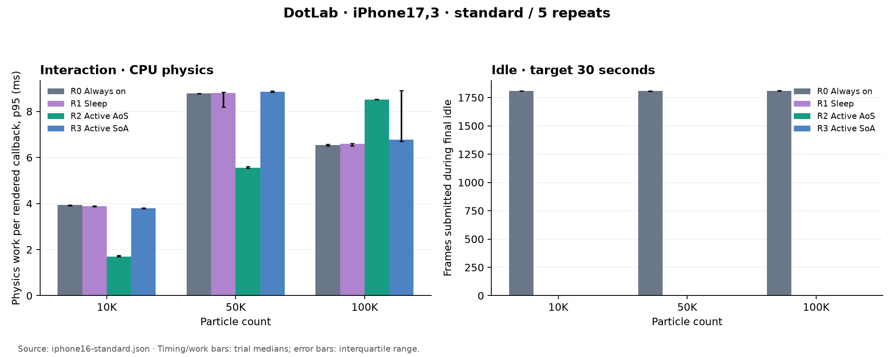
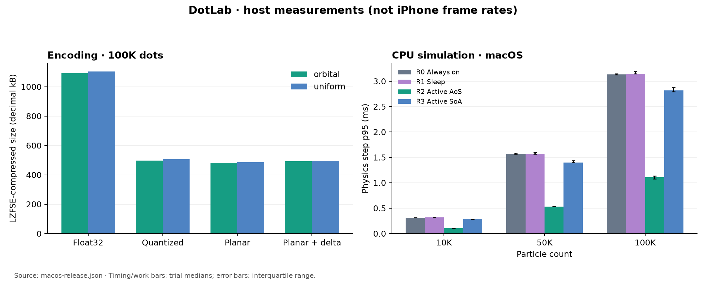
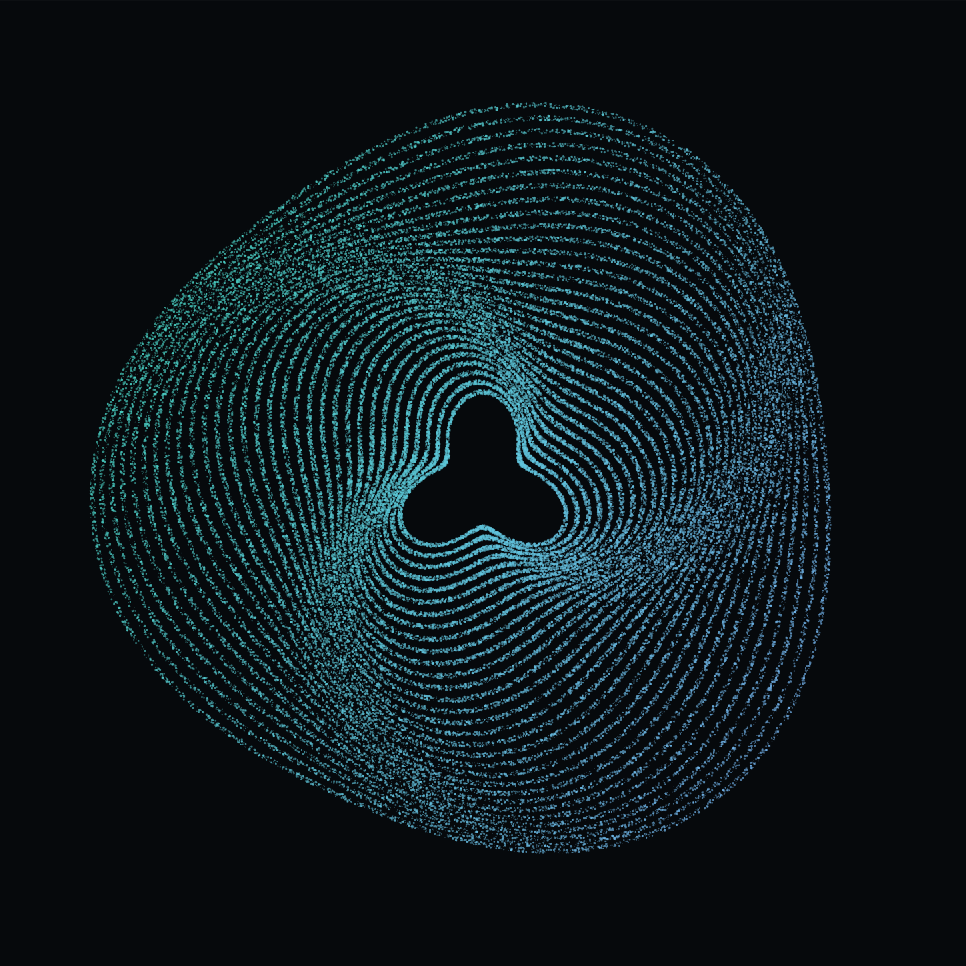
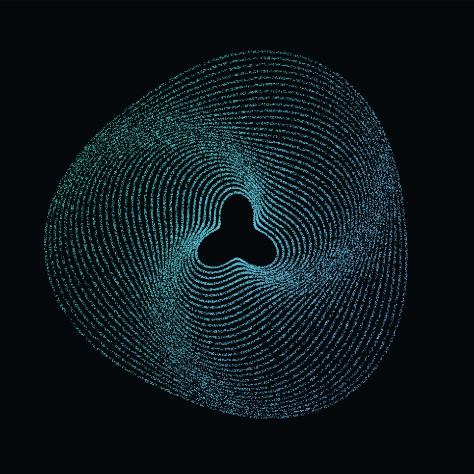
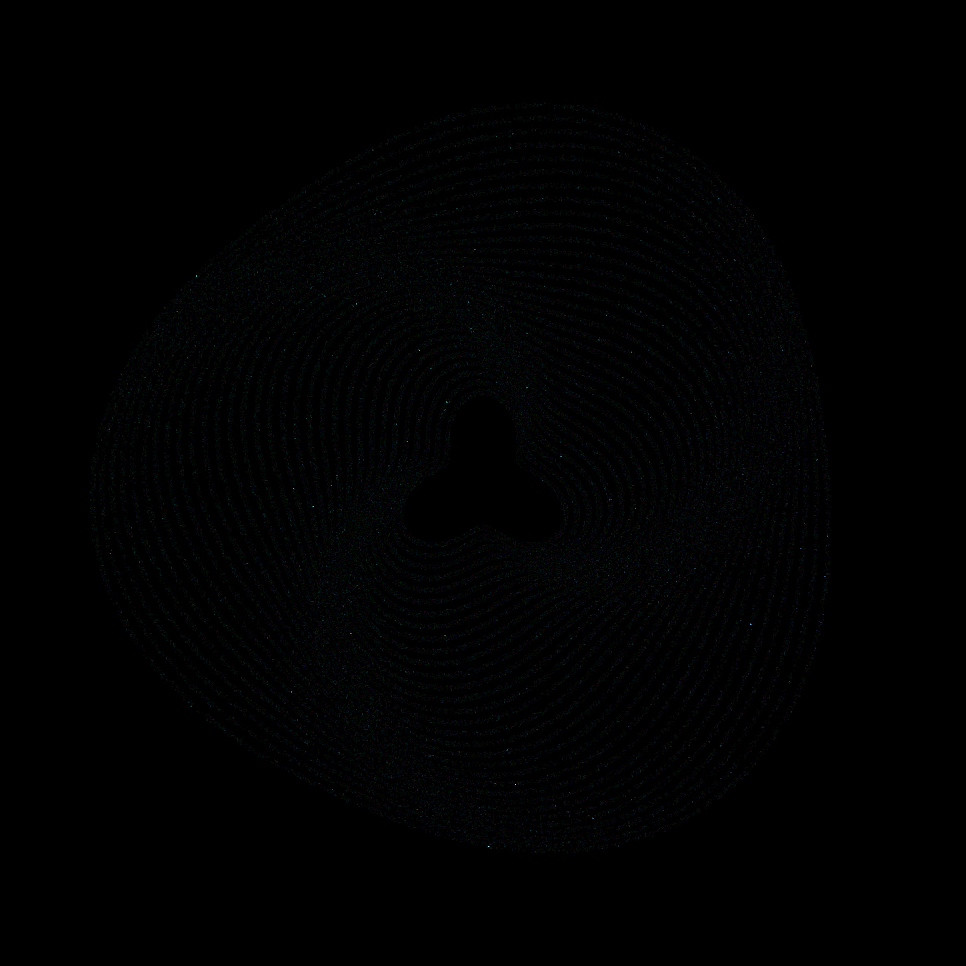

# Recorded experiments

Measurements collected on 26 October 2026. Raw JSON is retained alongside generated Markdown and figures. Timing, memory, rendering behavior, and energy are distinct measurements.

## Physical iPhone 16: full standard run

[Raw device data](iphone16-standard.json) · [all 60 trials](iphone16-standard.md)

- iPhone 16 (`iPhone17,3`), Apple A18 GPU, iOS 26.6.1 (23G83).
- Release build from `8c5d23e`, tagged `device-baseline-2026-10-26`; Xcode 27.0 / iOS 27 SDK.
- Five repeats of all four modes at each of 10K, 50K, and 100K dots: **60 completed trials**.
- Every trial settled; maximum observed settling duration was **1.247 seconds**.
- Thermal state was nominal at both ends of every trial.
- No recorded Metal command errors.
- All **45 optimized trials** submitted **zero final-idle frames and zero final-idle physics steps**. R0 submitted a median of roughly 1,808 frames during its target 30-second idle phase.
- The benchmark ran in the foreground without an attached profiler. Checkpoint JSON was transferred periodically through the device tools. Screen brightness, battery/charging state, Low Power Mode, and other system workloads were not independently controlled or recorded, so this is one device session rather than a laboratory-wide hardware comparison.

The following values are medians of five per-trial p95 measurements. Physics is elapsed CPU-side simulation work per rendered callback; GPU is command-buffer execution. Callback intervals are not compositor presentation timestamps.

| Dots | Mode | Physics p95 (ms) | GPU p95 (ms) | Callback interval p95 (ms) | Estimated missed refreshes across 5 interaction phases |
|---:|---|---:|---:|---:|---:|
| 10K | R0 Always on | 3.933 | 0.580 | 16.669 | 1 |
| 10K | R1 Sleep | 3.892 | 0.572 | 16.669 | 0 |
| 10K | R2 Active AoS | 1.695 | 0.572 | 16.665 | 2 |
| 10K | R3 Active SoA | 3.787 | 0.572 | 18.113 | 1 |
| 50K | R0 Always on | 8.778 | 2.717 | 16.675 | 0 |
| 50K | R1 Sleep | 8.800 | 2.713 | 16.677 | 9 |
| 50K | R2 Active AoS | 5.563 | 2.727 | 16.666 | 0 |
| 50K | R3 Active SoA | 8.860 | 2.720 | 16.677 | 2 |
| 100K | R0 Always on | 6.535 | 5.175 | 16.680 | 0 |
| 100K | R1 Sleep | 6.588 | 5.170 | 16.685 | 4 |
| 100K | R2 Active AoS | 8.524 | 5.207 | 16.689 | 4 |
| 100K | R3 Active SoA | 6.771 | 5.184 | 16.676 | 12 |

At the primary **50K** workload, active AoS reduced the median per-trial p95 physics time by **36.6%** relative to R0. Its callback interval was consistent with the 60 FPS target, with zero estimated missed refreshes across the five interaction phases. This supports the prototype's target under this recorded session; it is not a compositor-level guarantee on every device.

At **100K**, the dense scan and SoA physics measurements were lower than active AoS. The host microbenchmark's ranking did not transfer uniformly to this phone. The counterintuitive improvement of some 100K timings relative to 50K is also a reason to investigate clock scaling, execution patterns, scheduling, and thermal/power conditions rather than infer a universal complexity result. Raw samples and trial order are retained so this can be examined.

The iPhone's 100K orbital open-time p50 was **0.654 ms** for quantized interleaved data and **1.998 ms** for planar data; compressed sizes were identical to the host's outputs. The planar format's modest additional size saving still had a decode cost in this implementation.

**Decision:** keep idle suspension in every optimized mode; use active AoS for the default 50K playground; retain all modes for comparison. The primary target did not establish a need for a GPU compute simulation, so it was not added. A different workload or slower device could change that decision.

## Host: Apple M3 Max

- macOS 27.0.1, Xcode 27.0, Swift 6.4, Release configuration.
- [Raw timing/work data](macos-release.json) and [full table](macos-release.md): 24 encoding rows and 60 CPU simulation trials.
- [Raw memory data](macos-memory.json) and [memory table](macos-memory.md): 120 fresh-process decoder samples and 60 fresh-process simulation samples.
- Simulation and codec algorithms match the tagged [device baseline source](https://github.com/malperk/dotlab-ios/tree/device-baseline-2026-10-26). The separate memory probe is in commit `952882c`.
- The final host timing run started after compilation had finished. Other ordinary host processes were not disabled. The memory probe and renderer are separate processes; memory results must not be presented as iPhone memory measurements.

For 100K orbital dots:

| Format | Raw bytes | LZFSE bytes |
|---|---:|---:|
| Float32 interleaved | 1,200,016 | 1,091,786 |
| Quantized interleaved | 500,016 | 496,680 |
| Quantized planar | 500,016 | 481,789 |
| Quantized planar + delta | 500,016 | 492,947 |

Quantization cuts raw size by **58.3%**. Planar quantization is **55.9% smaller than compressed Float32**, but only **3.0% smaller than compressed interleaved quantization**. Deltas make this particular payload **2.3% larger** than planar values alone. This distribution does not reproduce the source article's compression ratio.

The interleaved quantized decoder opens this dataset in about **0.75 ms** on this host; the current planar decoder takes about **2.44 ms**. Its small additional byte saving comes with a decode cost. These are the measured implementations, including validation and reconstruction, rather than an intrinsic ranking of every possible decoder.

At 100K orbital dots, the fresh decoder process peaks at roughly **10.4 MiB** for Float32 and **8.5 MiB** for the quantized formats. The decoded dot array is still Float32 in every case. Smaller storage does not imply a five-byte runtime particle.

The host CPU microbenchmark favors active AoS. SoA's sparse accesses, field-by-field array operations, and duplicated home-coordinate storage are implementation/workload characteristics to investigate; the host result must not be generalized to every device or SoA algorithm.

## Simulator: behavior validation

[Raw smoke data](simulator-smoke.json) · [full table](simulator-smoke.md)

All 12 count/mode combinations settled. R1/R2/R3 submitted zero frames and performed zero physics steps during final idle. R0 continued rendering. No Metal command errors were recorded. Simulator CPU/GPU durations are included for audit but are not evidence about iPhone performance.

## Image comparison

[Pixel comparison data](visual-comparison.json)

The same 100K source dots were rendered on the same simulator at rest. The comparison covers a 966×966-pixel field crop and excludes changing interface/status-bar pixels.

| Float32 reference | Quantized planar |
|---|---|
|  |  |

All three quantized layouts produced identical field pixels to each other. Relative to Float32, mean absolute channel error was **0.1115 / 255**, the 99th-percentile channel error was **2 / 255**, and maximum local channel error was **44 / 255**. About **14.18%** of field pixels changed by at least one channel value. Local rasterization differences are real even when average error is small.

The independently measured geometric error is at most **0.01272 physical pixels in position** and **0.00925 pixels in radius** at the declared 1179×1179 viewport, below the chosen 0.25-pixel threshold. This is a quantified tolerance check and visual inspection, not a universal perceptual-equivalence claim.

## Interpretation boundaries

Power profiling was attempted separately after the standard suite. On this Mac, Instruments could not discover the running app by name or exact PID even though `devicectl` listed it. Direct Power Profiler launch ran to the time limit, then `xctrace` exited with code 133 and left a partial recording that its export command rejected. No usable CPU-utilization, display-presentation, or power trace was obtained. Those measurements remain unverified; no battery percentage or power-impact reduction is reported. The iPhone was relaunched into the default resting mode afterward.

- Compare the same workload, device, build, phase, and units. A host physics step, a rendered callback, and an on-screen presentation are different intervals.
- Sleep avoids this renderer's idle work. The UI's fixed 2 Hz metrics refresh and system processes can still use CPU.
- Active-set bookkeeping can cost more than a dense scan at some scales. AoS/SoA results can also differ across hardware.
- iPhone suite RSS includes retained earlier-trial results. Use the isolated probe or Instruments for memory attribution.
- No battery-life percentage is inferred from frame counts, submission time, or host timings.
- The default 50K playground uses active AoS. GPU compute remains conditional on profiling demonstrating a CPU bottleneck that prevents the target experience.

The exact protocol and acceptance rules are in [PROTOCOL.md](../Docs/PROTOCOL.md). Figure generation and result summarization are deterministic transformations of the corresponding JSON; rerunning measurements can change timing and memory values.
